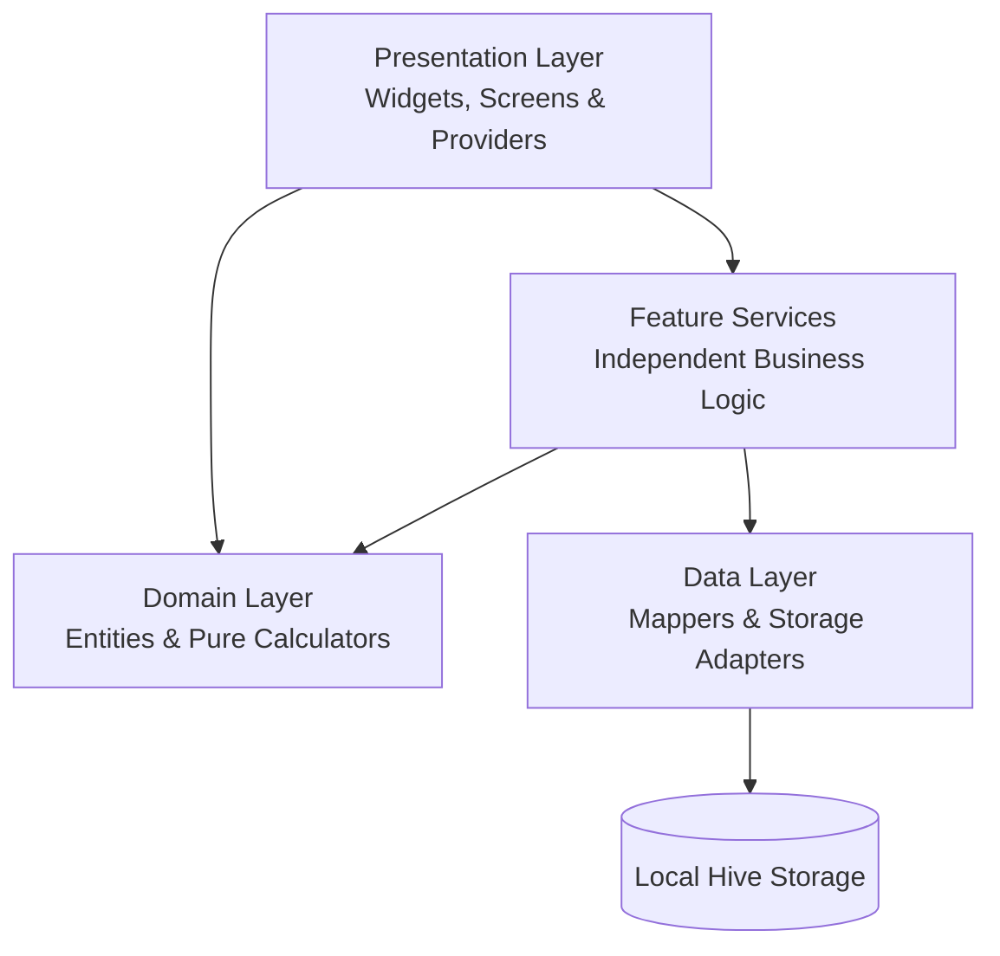

# Architecture & Design System

The **Student Expense Tracker** application is engineered with an offline-first, modular architecture prioritizing high maintainability, strict separation of concerns, and resilience against failures.

---

## High-Level Architecture

The project follows a layered and feature-modular structure:

---

## 1. The Strict 65-LOC Rule

A core architectural principle of this codebase is the **Strict $\le 65$ LOC Rule**:
- Every `.dart` file is capped at a maximum of **65 lines of code**.
- Large, monolithic files are prohibited. Instead, logic is broken into focused single-responsibility micro-components, dedicated helpers, sub-widgets, and domain calculators.
- Benefits:
  - High testability: pure functions and small units are trivially verifiable.
  - Readability: zero cognitive overload per file.
  - Zero merge conflicts: isolated modules.

---

## 2. Layer Breakdown

### Presentation Layer (`lib/presentation/`)
- **Features (`lib/presentation/features/`)**: Self-contained screen views and focused widgets for each functional domain (`home`, `transactions`, `budgets`, `analytics`, `recurring_bills`, `savings_goals`, `accounts`, `split_expenses`, `settings`, `onboarding`).
- **Router (`lib/presentation/router/`)**: Declarative routing built on `go_router` (`AppRoutes`, `FeatureRoutes`, `AppRouter`).
- **Providers (`lib/presentation/providers/`)**: Reactive state management with `flutter_riverpod`, splitting service locators, data streams, and UI state into cleanly scoped files.
- **Widgets (`lib/presentation/widgets/`)**: Reusable UI components (progress bars, transaction tiles, empty states).

### Domain Layer (`lib/domain/`)
- **Entities (`lib/domain/entities/`)**: Pure Dart immutable models inheriting from `Equatable` (`Transaction`, `Account`, `Budget`, `Category`, `RecurringBill`, `SavingsGoal`, `SplitExpense`, `AppSettings`).
- **Use Cases & Calculators (`lib/domain/usecases/`)**: Pure deterministic financial calculations with zero external dependencies (`BudgetCalculator`, `RecurringBillCalculator`, `SplitCalculator`).

### Data Layer (`lib/data/`)
- **Mappers (`lib/data/mappers/`)**: Pure conversion functions mapping between Dart entities and raw JSON/Hive storage primitives (`transaction_mapper.dart`, `budget_mapper.dart`, etc.).

### Core Layer (`lib/core/`)
- **Services (`lib/core/services/`)**: Core infrastructure wrappers (`HiveService`, `NotificationService`).
- **Theme (`lib/core/theme/`)**: Minimalist monochrome visual design system with support for both dark and light themes.
- **Utils (`lib/core/utils/`)**: Date formatting, currency parsing, and icon resolution helpers.

### Feature Services (`lib/features/`)
- Each feature domain owns dedicated business logic services that operate directly with local boxes.
- Exception-safe: service methods handle local storage anomalies and degrade gracefully.

---

## 3. Storage & Offline First

- Powered by **Hive** key-value storage.
- All operations are synchronous or near-instantaneous local asynchronous writes.
- Complete data export/import via JSON and platform file sharing (`SharePlus`).

---

## 4. UI Design Philosophy

- **Monochrome & High Contrast**: A clean, distraction-free aesthetic with subtle grayscale accents, clean typography, and spacious padding.
- **Predictable Feedback**: Visual micro-indicators, animated progress bars, and bottom sheets for contextual user interaction.
